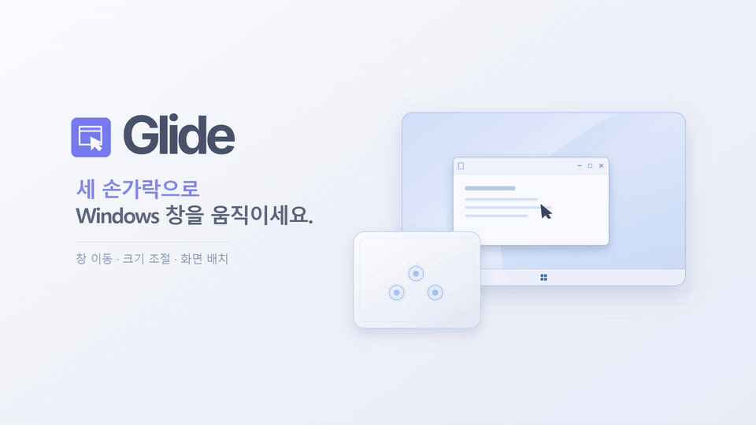
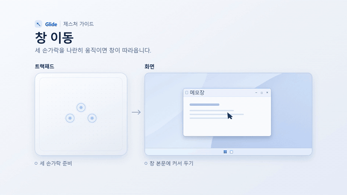
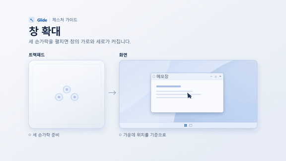
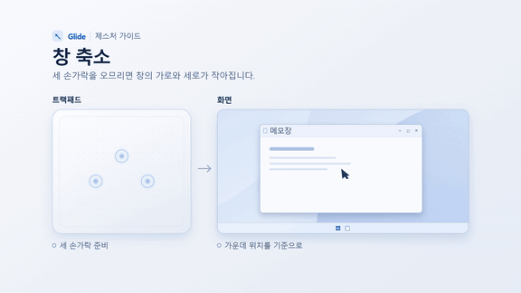
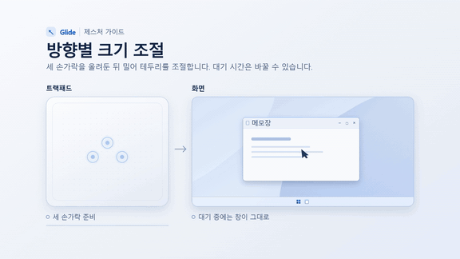
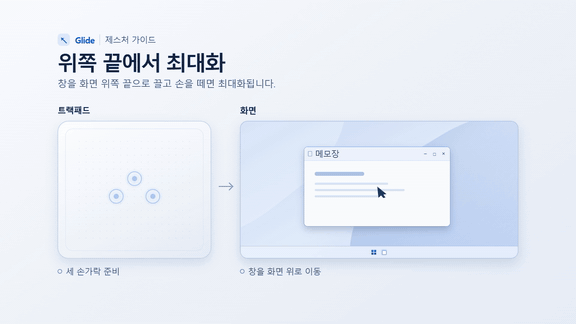
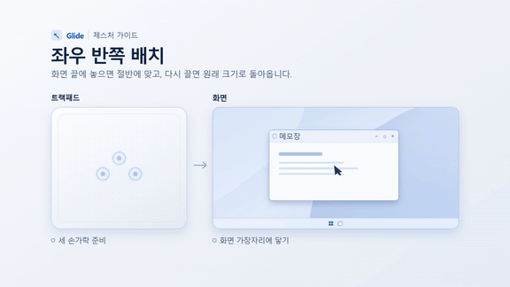
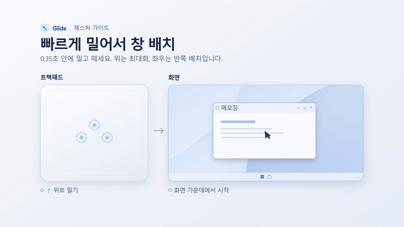

<h1 align="center">
  
</h1>

  <a href="README.md">English</a> · <strong>한국어</strong>

Windows 정밀 터치패드에서 **세 손가락으로 창을 옮기고, 크기를 조절하고, 화면에 배치**하는 앱입니다. 커서를 창 위에 놓고 세 손가락을 움직이면 됩니다. 제목 표시줄을 잡거나 터치패드를 누를 필요가 없습니다.

> Glide는 처음부터 끝까지 AI를 활용한 바이브 코딩으로 개발했습니다. 이 README와 소개 영상도 AI를 활용해 제작했습니다. 소스 코드는 별도로 검증하지 않았으므로, 사용 중 예상치 못한 문제가 발생할 수 있습니다.

## Glide 소개

[전체 제스처 영상 보기 (MP4, 46초)](docs/media/glide-gesture-guide.mp4)

## 다운로드와 설치

[GitHub Releases](https://github.com/kgu090716/glide/releases)에서 설치 파일 또는 포터블 압축 파일을 선택하세요.

| 파일 | 사용 방법 |
| --- | --- |
| `Glide-3.0.2-Setup.exe` | 설치 파일을 실행합니다. 로그인 시 자동 시작을 설치 중이나 앱의 **편의 기능**에서 설정할 수 있습니다. |
| `Glide-3.0.2-Portable.zip` | 압축 전체를 한 폴더에 푼 뒤 `ThreeFingerWindowDrag.exe`를 실행합니다. |

두 파일에 .NET과 WinUI 런타임이 포함되어 있습니다.

> 설치 파일과 포터블 실행 파일에는 디지털 서명이 없어 실행할 때 **Windows SmartScreen 경고**가 표시될 수 있습니다.

## 지원 환경

- **Windows 11 x64**와 **Windows 정밀 터치패드(Precision Touchpad)**가 있는 노트북이 기본 대상입니다. Glide가 세 손가락의 접촉 정보를 받을 수 있어야 합니다.
- 설치 프로그램의 최소 버전은 **Windows 10 버전 2004(빌드 19041)**입니다. 설치·실행은 개발에 사용한 Windows 11 노트북에서 확인했습니다. 다른 터치패드 모델과 Windows 10, ARM64 환경은 직접 검증하지 않았습니다.
- 일반 마우스로만 인식되는 터치패드와 일부 원격 데스크톱·가상 머신에서는 세 손가락 입력이 전달되지 않을 수 있습니다.

## 처음 실행할 때

1. 첫 실행 안내에서 **터치패드 설정 열기**를 누릅니다.
2. Windows **설정 → Bluetooth 및 장치 → 터치패드 → 세 손가락 제스처**에서 **살짝 밀기**와 **탭**을 각각 **아무 작업 안 함**으로 바꿉니다. Windows의 앱 전환과 Glide가 동시에 실행되는 것을 막기 위한 설정입니다.
3. Glide에서 **시작하기**를 누릅니다. 움직일 창 위에 커서를 놓고 세 손가락으로 밀어 보세요.

Glide 설정의 **언어**에서 English 또는 한국어를 선택할 수 있습니다. 변경 사항은 즉시 적용되고 다음 실행에도 유지됩니다.

## 제스처

| 하고 싶은 일 | 터치패드 동작 | GIF |
| --- | --- | --- |
| 창 옮기기 | 세 손가락을 나란히 움직입니다. **커서도 함께 이동**을 켜면 커서가 창 안의 상대 위치를 따라갑니다. |  |
| 창 키우기 | 세 손가락을 펼칩니다. |  |
| 창 줄이기 | 세 손가락을 오므립니다. |  |
| 창 테두리 조절하기 | 세 손가락을 **가만히 올려둔 뒤** 밉니다. 기본 대기 시간은 1초이며 **올려놓는 시간 (초)**에서 바꿀 수 있습니다. |  |
| 최대화하기 | 창을 화면 위쪽 끝까지 끌고 손을 뗍니다. |  |
| 한쪽 절반에 배치하기 | 창을 화면의 왼쪽 또는 오른쪽 끝까지 끌고 손을 뗍니다. |  |
| 빠르게 창 배치하기 | 세 손가락을 댄 뒤 **0.35초 안에** 빠르게 밀고 뗍니다. **↖·↑·↗**는 최대화, **←·→**는 해당 방향의 반쪽 배치입니다. |  |

Glide로 반쪽 배치한 창을 다시 끌면 배치 전 크기로 돌아옵니다. 설정에서 제스처를 각각 켜고 끌 수 있고, 이동 속도와 빠른 동작의 민감도도 조절할 수 있습니다.

- **Ctrl + Alt + F9**로 제스처를 일시정지하거나 다시 켭니다. **Esc**는 진행 중인 제스처를 취소합니다.
- 설정 창을 닫으면 알림 영역으로 숨습니다. 완전히 끄려면 Glide 트레이 아이콘을 우클릭해 **종료**를 선택하세요.
- 작업 관리자처럼 관리자 권한으로 실행된 창을 제어하려면 Glide에서 **편의 기능 → 관리자 권한으로 다시 시작**을 선택하세요.

## 문제가 생기면

터치패드가 감지되지 않으면 Glide의 **터치패드 → 다시 검색**을 눌러 보세요. 세 손가락 동작에 Windows 작업 보기나 앱 전환이 함께 뜨면 Windows 터치패드의 기본 제스처 설정을 확인하세요.

## 개발 과정

Glide는 윈도우에서 세 손가락으로 창을 옮기고 싶어서 시작한 개인 프로젝트입니다. 필요한 기능을 정하고 실제 노트북에서 써보며 동작을 다듬었습니다. 코드 구현, 디버깅, 테스트 작성에는 OpenAI Codex를 활용했습니다.
