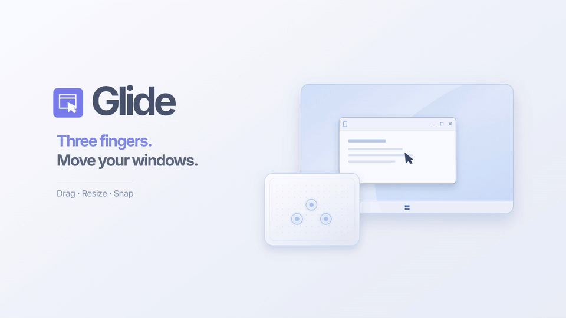
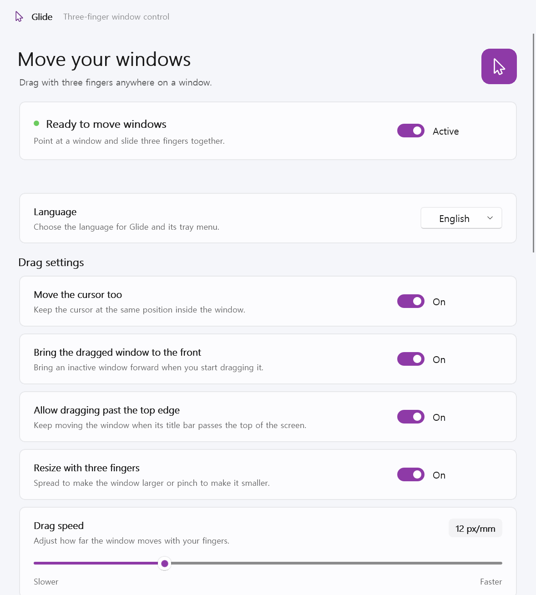
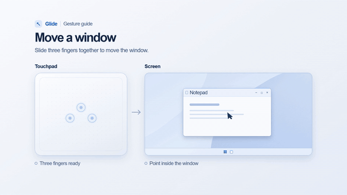
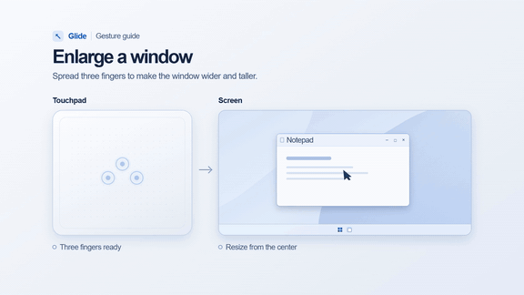
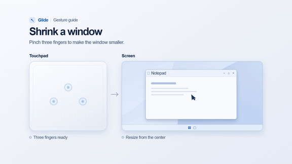
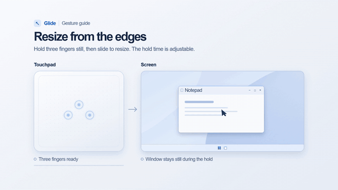
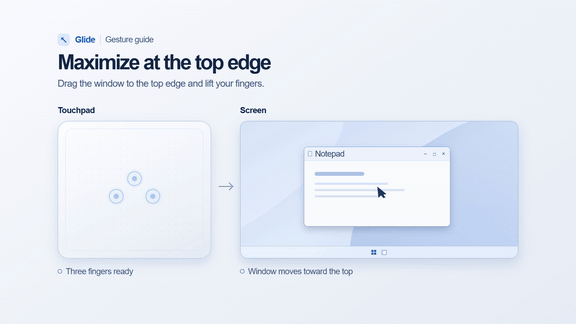
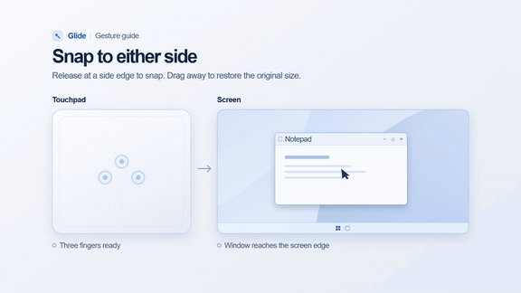
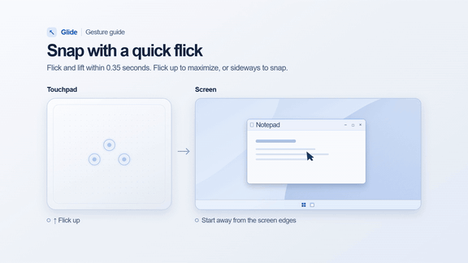

<h1 align="center">
  
</h1>

  <strong>English</strong> · <a href="README.ko.md">Korean</a>

Glide lets you **move, resize, and snap windows with three fingers** on a Windows Precision Touchpad. To move a window, place the pointer anywhere on it and drag three fingers together without clicking.

> Glide was built from start to finish through AI-assisted vibe coding. AI was also used to create this README and the demo videos. The source code has not been independently verified, so you may encounter unexpected issues.

## See Glide in action

[Watch the full gesture guide (MP4, 46 seconds)](docs/media/glide-gesture-guide-en.mp4)

## App screenshot

  

## Download and install

Choose the installer or the portable ZIP from [GitHub Releases](https://github.com/kgu090716/glide/releases).

| File | How to use it |
| --- | --- |
| `Glide-3.0.2-Setup.exe` | Run the installer. You can enable launch at sign-in during setup or under **Convenience** in Glide. |
| `Glide-3.0.2-Portable.zip` | Extract the entire archive into a folder and run `ThreeFingerWindowDrag.exe`. |

Both downloads include the .NET and WinUI runtimes.

> **Windows SmartScreen** may show a warning when you run Glide. The installer and portable executable are unsigned.

## System requirements

- Glide is designed for **Windows 11 x64** laptops with a **Windows Precision Touchpad** that reports three simultaneous finger contacts.
- The installer requires at least **Windows 10 version 2004 (build 19041)**. Installation and launch were checked on the Windows 11 development laptop. Other touchpad models, Windows 10, and ARM64 have not been verified directly.
- A touchpad detected only as a mouse may fail to report three-finger input. The same can happen in some Remote Desktop sessions and virtual machines.

## First launch

1. Select **Open touchpad settings** in Glide's first-launch dialog.
2. In Windows, open **Settings → Bluetooth & devices → Touchpad → Three-finger gestures**. Set both **Swipes** and **Taps** to **Nothing** so Windows does not perform its own actions during a Glide gesture.
3. In Glide, select **Get started**. Hover over a window and slide three fingers across the touchpad.

Choose English or Korean under **Language** in Glide. The change takes effect immediately and is saved for future launches.

## Gestures

| Action | Touchpad gesture | GIF |
| --- | --- | --- |
| Move a window | Slide three fingers together. Enable **Move the cursor too** to keep the cursor at the same relative position inside the moving window. |  |
| Enlarge a window | Spread three fingers apart. |  |
| Shrink a window | Pinch three fingers together. |  |
| Resize from the edges | Hold three fingers still, then slide. The default hold time is one second. You can adjust it in the **Hold time** field. |  |
| Maximize a window | Drag the window to the top edge of the screen and lift your fingers. |  |
| Snap a window to one half | Drag the window to the left or right edge of the screen and lift your fingers. |  |
| Snap with a quick flick | Touch down with three fingers, flick, and lift within **0.35 seconds**. **↖, ↑, and ↗** maximize the window. **← and →** snap it to the corresponding half. |  |

Drag a window away after snapping it with Glide to restore its previous size. You can turn gestures on or off individually and adjust drag speed and flick sensitivity.

- Press **Ctrl + Alt + F9** to pause or resume gestures. Press **Esc** to cancel an active gesture.
- Closing the settings window hides Glide in the Windows notification area. To quit, right-click the Glide tray icon and select **Exit**.
- To control an elevated window such as Task Manager, select **Convenience → Restart as administrator** in Glide.

## Troubleshooting

If Glide does not detect the touchpad, select **Touchpad → Scan again**. If Task View or app switching opens during a Glide gesture, check the Windows touchpad settings from [First launch](#first-launch).

## How Glide was built

Glide started as a personal project to bring three-finger window dragging to Windows. I chose the features and refined how they work by using them on my laptop. I used OpenAI Codex to implement the code, debug it, and write tests.
